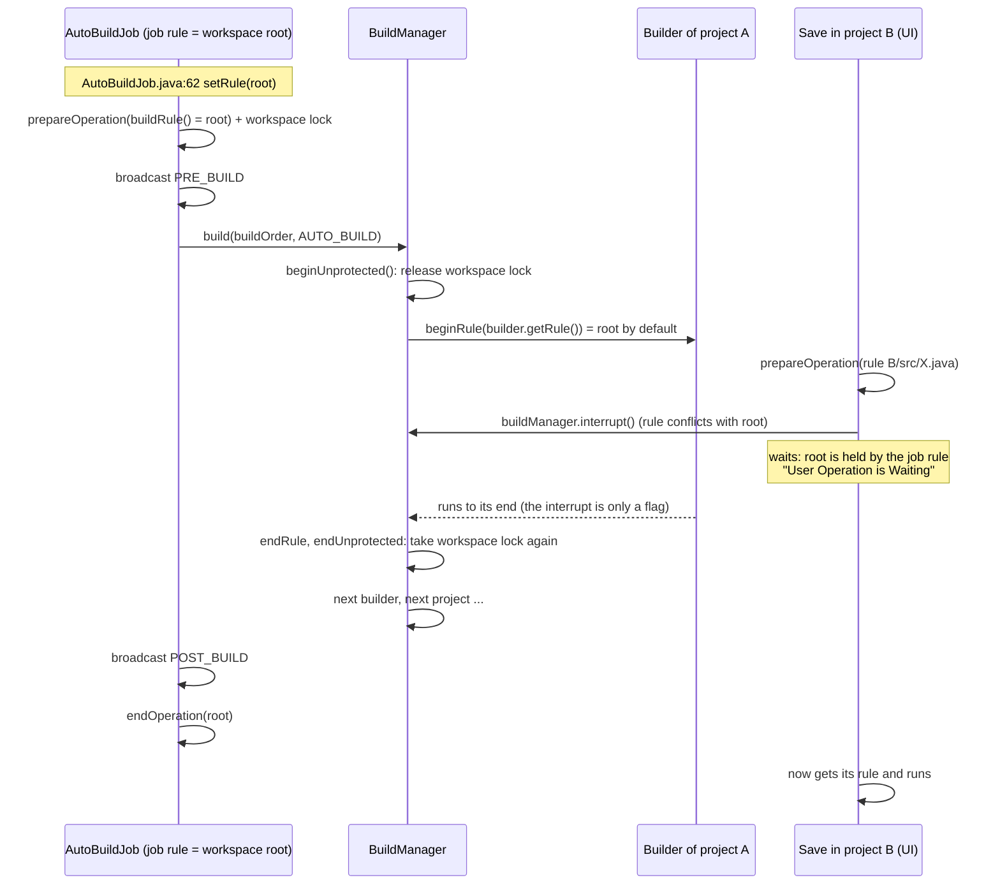
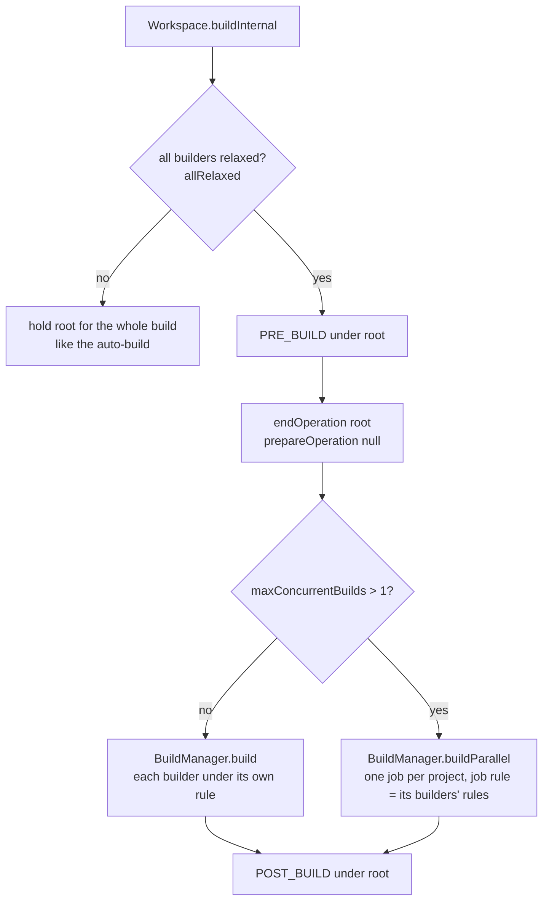
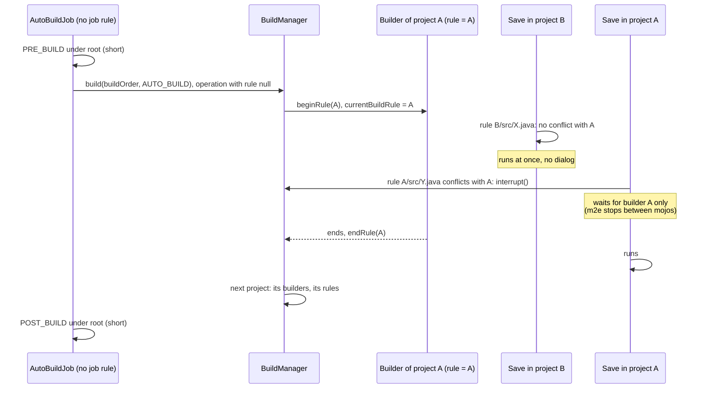

# Plan: project-level build locks instead of one workspace lock

Status: proposal, 2026-11-13. Branch `build-yield-enforcement` in `anydoby/eclipse.platform`.
Related m2e work: `anydoby/m2e-core` branch `mojo-timing`.

## Goal

A build of project A must not block a save, an editor open, or any other change in project B.
Today one auto-build blocks every change in the whole workspace until the build ends.

## 1. How it works on master

### 1.1 The locks

There are two locks. An operation must hold both to change the resource tree.

| Lock | What | Who takes it |
|---|---|---|
| Scheduling rule | `IJobManager.beginRule(rule)`, or the rule of a `Job` | each operation (`WorkManager.checkIn`), each job, each builder |
| Workspace lock | `ILock` in `WorkManager` | each operation, after its rule (`WorkManager.checkIn`) |

A save of `B/src/X.java` takes the rule `B/src/X.java` (`ResourceRuleFactory.modifyRule` returns the
file itself), then the workspace lock.

### 1.2 The auto-build

Facts, with places in the code:

1. `AutoBuildJob` has the job rule `workspace root` (`AutoBuildJob.java:62`) for its whole run.
2. `AutoBuildJob.doBuild` also starts an operation with `Rules.buildRule()`, which is always the
   workspace root ("team hook currently cannot change this rule", `Rules.java:57`).
3. While a builder runs, `BuildManager.basicBuild` releases the workspace lock
   (`beginUnprotected()`) and takes the builder's rule (`beginRule(rule)`). So the workspace lock is
   **not** the blocker during a builder. The blockers are the job rule (1) and the operation rule (2).
4. `IncrementalProjectBuilder.getRule()` returns the workspace root by default. JDT's `JavaBuilder`
   does not override it. m2e's `MavenBuilder` returns the root, or `null` with its experimental
   "Minimize lock during build" option (no lock at all).
5. `Workspace.prepareOperation` calls `buildManager.interrupt()` for every operation whose rule
   conflicts with `buildRule()`. Every rule conflicts with the root, so every save in any project
   asks the build to stop. The builder must check `isInterrupted()`; most do not.
6. `isBlocking()` (`JobManager.java:940`) finds jobs queued behind the auto-build job and threads
   waiting in `beginRule` whose rule conflicts with the job's rule.

### 1.3 What the platform already supports: relaxed rules (Bug 343256, Eclipse 3.7)

`Workspace.buildInternal` (manual builds: Project > Build, launch "build before launch") already does
what we want, but only if **all** builders of the build return a *relaxed* rule (a rule that does not
contain the root):

`BuildManager.basicBuild` is ready for concurrent changes: after it gets the builder's rule it takes
a new tree snapshot, so the delta has all changes inside the rule (`BuildManager.java:296-301`).
The API contract (`IncrementalProjectBuilder.getRule` Javadoc) already says that a relaxed builder
can see an incomplete delta for projects outside its rule.

### 1.4 Why this does not help today

| Gap | Where | Effect |
|---|---|---|
| G1 | `AutoBuildJob` never uses the relaxed path | every auto-build locks the root, even with relaxed builders |
| G2 | `allRelaxed` is all-or-nothing | one root builder anywhere makes the whole build lock the root |
| G3 | `prepareOperation` interrupts on conflict with `buildRule()` = root | every save stops the build, also when it does not wait for it |
| G4 | JDT and m2e builders return the root | no Java or Maven project is relaxed |
| G5 | m2e refreshes its project registry inside the builder with `beginRule(root)` | m2e cannot simply return a project rule: the nested `beginRule(root)` would fail |

## 2. What I suggest

### 2.1 Target picture

Lock scope over time, one auto-build of projects A and B:

```mermaid
gantt
    dateFormat X
    axisFormat %s
    section master
    root (job rule + operation)          :0, 10
    section proposal
    root (PRE_BUILD)                     :0, 1
    A (builders of A)                    :1, 6
    B (builders of B)                    :6, 9
    root (POST_BUILD)                    :9, 10
```

### 2.2 Changes, in the order I would make them

#### Phase 0: clean up the branch

- Revert `4c49d41500` (`BuilderYieldEnforcer`). Reasons: a race in `finish()` (a late check can
  interrupt the next builder), a cancel that ends in `OperationCanceledException` still makes the
  platform call `forgetLastBuiltState()` (next build is a full build, which `requestRememberState()`
  cannot undo), and `Thread.interrupt()` for every builder can leave half-written files. With
  project rules most of the need goes away.
- Optional, separate small change: keep only its log message ("a user operation waited N ms for
  builder X"). It names the slow builder without a thread dump.

#### Phase 1: platform, `org.eclipse.core.resources` (no API change needed for the core)

1. **Auto-build uses the relaxed path (G1, G2).** `AutoBuildJob` gets no job rule. `doBuild` holds
   the root only for PRE_BUILD and POST_BUILD, like `Workspace.buildInternal`. Between them it runs
   `BuildManager.build` in an operation with rule `null`. `BuildManager.basicBuild` already takes
   each builder's own rule. A builder that returns the root still gets the root, but only while it
   runs. So the decision is per builder, not all-or-nothing, and workspaces with old builders keep
   the old behavior for exactly those builders.
2. **Interrupt only on a real conflict (G3).** `BuildManager` keeps the rule of the builder that runs
   now (`currentBuildRule`, `null` between builders). `Workspace.prepareOperation` calls
   `interrupt()` only if the incoming rule conflicts with that rule, or with the root during
   PRE_BUILD/POST_BUILD.
3. **`isInterrupted()` must still see blocked jobs.** Without a job rule, `isBlocking()` may not see a
   job that waits for the builder's rule (fact 6). To verify first. If needed, a small addition in
   `org.eclipse.core.jobs`, for example `IJobManager#isBlocking(ISchedulingRule)` (new API, minor
   version), or `AutoBuildJob` checks the waiting jobs against `currentBuildRule` itself.
4. **Kill switch.** System property `org.eclipse.core.resources.relaxedAutoBuild=false` gives back
   the master behavior. A preference constant in `ResourcesPlugin` later, if reviewers want it
   (API addition, minor version).
5. **Keep what must stay serial.** One auto-build at a time (no change). PRE_BUILD and POST_BUILD once
   for each build (no change). Parallel project builds stay controlled by `maxConcurrentBuilds`
   (default 1); this plan does not need them.

Tests (`org.eclipse.core.tests.resources`): test builders with a project rule. While a builder of A
blocks, a `setContents` in B ends at once; a `setContents` in A waits and interrupts; the next build
of A gets the change; PRE_BUILD/POST_BUILD come once; a root builder still blocks everything during
its run; the kill switch gives the old behavior.

#### Phase 2: m2e, `org.eclipse.m2e.core` (on top of `mojo-timing`)

1. **`MavenBuilder.getRule()` returns the project** when no pom input changed. `getDelta()` works in
   `getRule()`, because `BuildManager` sets both trees before it calls it. It returns the root when:
   the delta contains `pom.xml` (or a workspace parent pom), or the facade is stale or missing, or
   the kind is `FULL_BUILD`/`CLEAN_BUILD` (keeps today's behavior for rare builds). This fixes G5:
   the registry refresh with `beginRule(root)` happens only in builds that hold the root.
2. **Safety net.** If the builder holds only the project rule but still finds a stale facade (for
   example the pom changed between `getRule()` and the build), it does not refresh inline. It
   schedules `ProjectRegistryRefreshJob`, calls `rememberLastBuiltState()` and returns. The job takes
   the root after the build; its change starts the next build.
3. **Check the other rules m2e takes in a build.** Resource refresh and markers are in the project
   (fine). Files that a mojo writes in another project are already skipped by `refreshResources`.
   Maven runs stay serial: there is one auto-build thread, and m2e jobs that run Maven use the root.
4. The old "Minimize lock during build" option (`null` rule) becomes unnecessary. Keep it, but the
   new default is the project rule.

Tests (`org.eclipse.m2e.core.tests`): with the Phase 1 platform, a mojo that blocks in project A does
not block a save in project B; a pom change still refreshes the registry and the classpath.

#### Phase 3: JDT, `org.eclipse.jdt.core` (upstream discussion needed)

`JavaBuilder.getRule()` returns the project plus every output folder outside the project
(`MultiRule`). To check before coding:

- Does the builder write outside its project (output folders in other projects, linked folders)?
- Classpath container and variable initialization during a build: can it start workspace operations
  that need other projects' rules? (`JavaCore.setClasspathContainer`)
- Annotation processing (APT) writes generated sources in the project: fine, but check the
  `GeneratedFileManager` refresh path.
- JDT reads the output of prerequisite projects. These change only in their own builds, which run
  before A in the build order, so the documented delta caveat does not lose changes for JDT.

First as an opt-in system property in JDT, then the default after reviews. Without Phase 3, Java-only
projects still lock the root while `JavaBuilder` runs, but m2e projects get the gain for the Maven
builder, which is usually the slow one.

#### Phase 4: other builders

m2e-wtp, Spring tools, and so on keep the root until they opt in. Thanks to Phase 1.1 they block the
workspace only while they run, not for the whole build.

### 2.3 Risks

| Risk | Mitigation |
|---|---|
| A builder relies on "nothing changes during the whole build" | only builders that return a relaxed rule are affected; the contract already allows concurrent changes outside the rule |
| Resource change listeners (POST_CHANGE) run on another thread while a builder runs | already true for manual relaxed builds since 3.7; test with JDT's `DeltaProcessor` |
| Delta for projects outside the rule misses concurrent changes | documented contract; JDT depends on prerequisite output, which only builds change |
| `isBlocking()` does not see waiting jobs | verify first; small jobs API addition if needed |
| Team providers (`IResourceRuleFactory` hooks) expect root during builds | `Rules.buildRule()` stays the root for PRE_BUILD/POST_BUILD; kill switch |

### 2.4 API summary

| Change | Bundle | Kind |
|---|---|---|
| auto-build per-builder rules, interrupt on real conflict | core.resources | internal |
| system property kill switch | core.resources | none |
| optional preference constant for the kill switch | core.resources | API addition, minor bump |
| optional `IJobManager#isBlocking(ISchedulingRule)` | core.jobs | API addition, minor bump |
| `MavenBuilder.getRule()` project rule | m2e.core | behavior, no API |
| `JavaBuilder.getRule()` project + outputs | jdt.core | behavior, no API |

### 2.5 How this fits the m2e work

| m2e change (`mojo-timing`) | Still needed with project locks? |
|---|---|
| stop between mojos when a save waits | yes, for saves in the same project |
| slow-mojo warning + "run on full builds only" quick fix | yes, a launch still waits for the whole build |
| cancel keeps the build state | yes |
| experimental interrupt + `target/` clean-up | less, only for the same project; keep it experimental |

## 3. Open questions for the user

1. Phase 1.3: is a small `org.eclipse.core.jobs` API addition acceptable if `isBlocking()` cannot
   see waiting jobs? (I think yes, given the "API changes are fine" guidance.)
2. Phase 3: open the JDT discussion early (an issue in `eclipse-jdt/eclipse.jdt.core`), or first
   show Phases 1 and 2 working?
3. Upstream order: platform first (an issue plus a draft PR), m2e after the platform change is in a
   milestone, because m2e must also run on older platforms (the project rule is harmless there: the
   old auto-build holds the root anyway).
